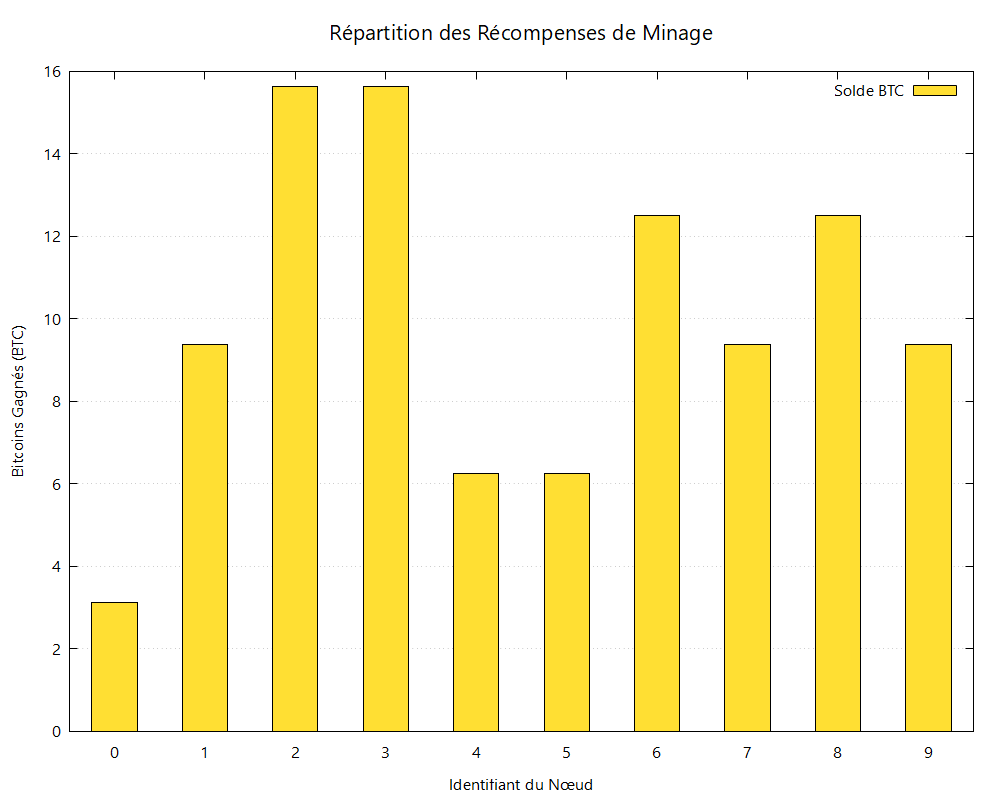
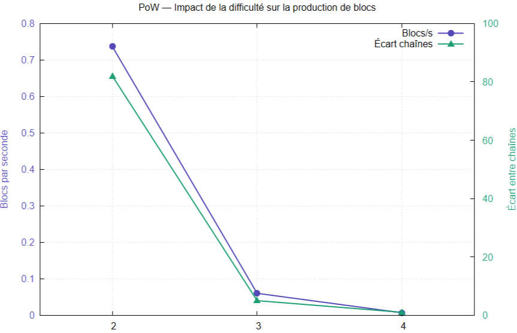
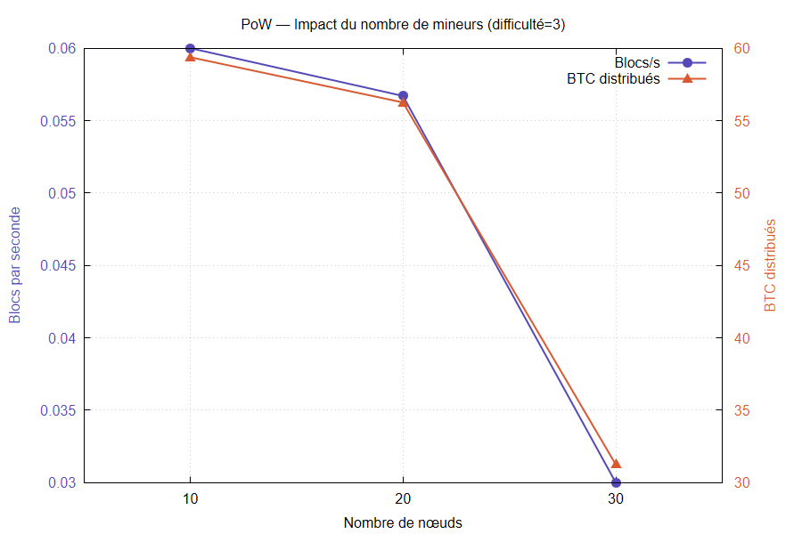
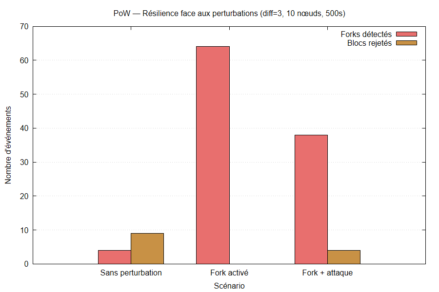
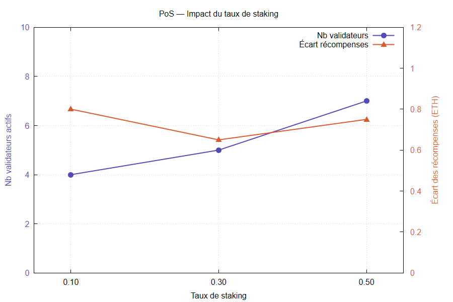
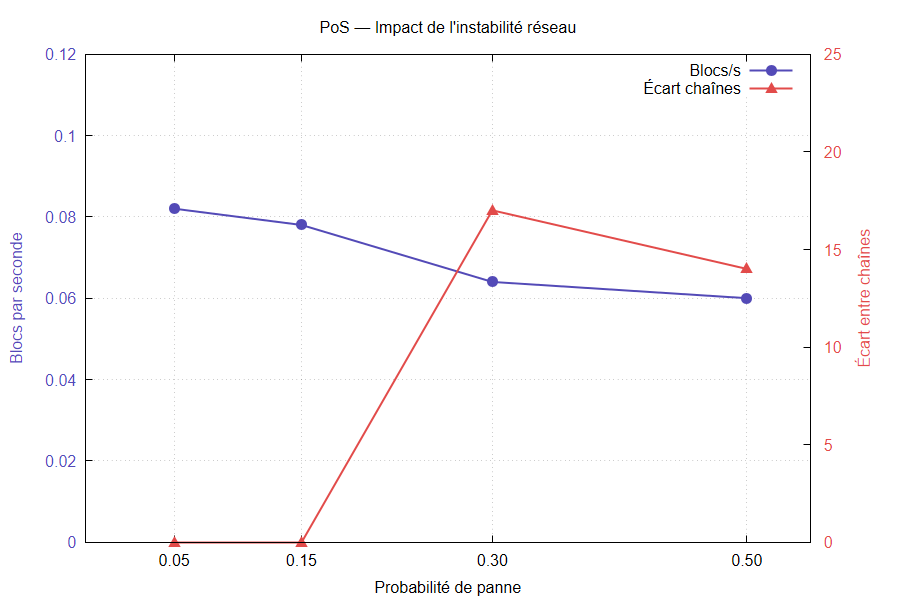
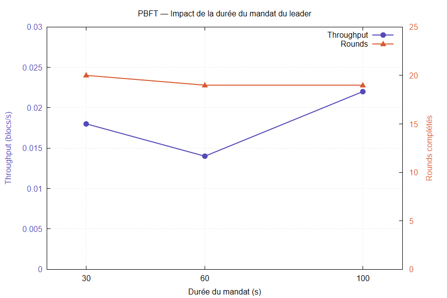
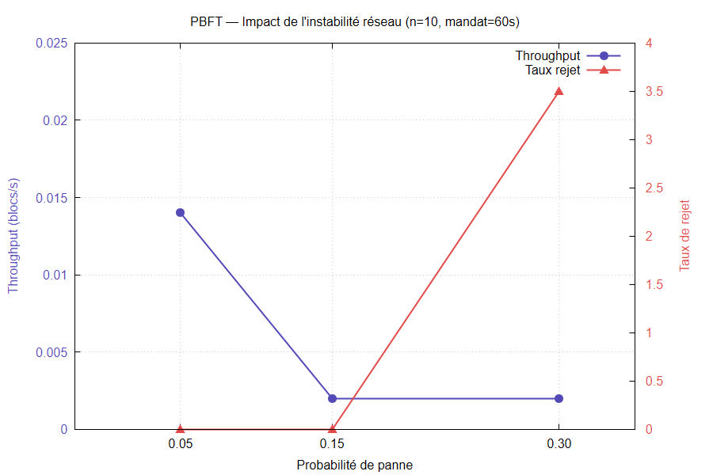
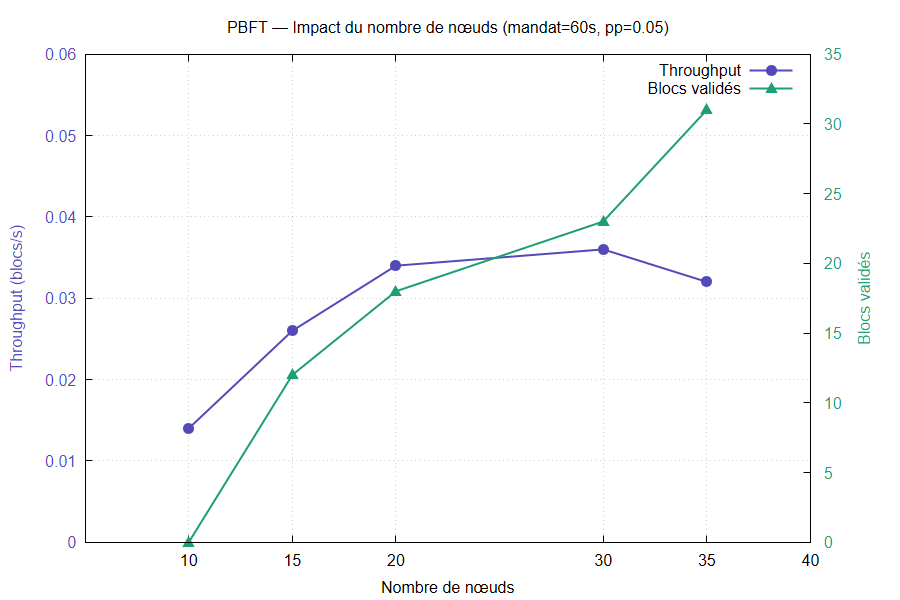

# Compte Rendu : Simulation et visualisation des consensus de la blockchain

**Auteurs :** Boussad HAMMOUM & Hocine HAMAMA  
**Établissement :** Université du Havre, Normandie  
**Formation :** Master 1 Informatique - IWOCS  
**Année universitaire :** 2025-2026  

---

## 1. Introduction

Les blockchains représentent une révolution technologique majeure dans la manière dont l'information est validée, stockée et échangée de manière décentralisée. Au cœur de ces systèmes se trouvent les protocoles de consensus, des mécanismes essentiels permettant à un ensemble de nœuds distribués sur un réseau de parvenir à un accord global sur l’état du registre, sans autorité centrale.

Cependant, ces protocoles, bien qu'ils soient partout dans la littérature scientifique et les applications industrielles, demeurent souvent abstraits et difficiles à appréhender. Leur complexité réside dans la simultanéité des échanges, la nature probabiliste de certaines validations et la gestion des pannes ou des comportements malveillants des participants.

L’objectif principal de ce projet de **Travail Personnel Encadré (TPE)** est de concevoir un outil de simulation pédagogique et interactif permettant de **visualiser et comprendre le fonctionnement interne de différents protocoles de consensus**. L’approche retenue vise à « rendre visible l’invisible », en offrant une représentation graphique de la manière dont les nœuds d’un réseau blockchain collaborent pour valider et enregistrer des transactions.

La méthodologie adoptée repose sur deux axes complémentaires :

1. L’implémentation des mécanismes fondamentaux de plusieurs protocoles de consensus majeurs :
   * Le **Proof of Work (PoW)**, utilisé notamment par Bitcoin et reposant sur la puissance de calcul ;
   * Le **Proof of Stake (PoS)**, popularisé par Ethereum 2.0 et fondé sur la détention de jetons comme garantie économique ;
   * Le **Practical Byzantine Fault Tolerance (PBFT)**, largement exploité dans les blockchains privées et consortiums.
2. Le développement d’un **simulateur de consensus blockchain** intégrant les protocoles PoW, PoS et PBFT, permettant à la fois de visualiser les échanges entre nœuds (propagation de blocs, forks, pannes) et de mesurer leurs effets sur le débit, la sécurité et la résistance aux pannes.

Ce projet a également pour ambition d’intégrer, dans une phase ultérieure, la simulation de scénarios d’attaques réseau afin d’illustrer les risques et les limites de chaque protocole. À titre d’exemple, la modélisation d’une **attaque des 51%** sur le PoW démontrera comment un acteur malveillant peut construire une chaîne alternative pour invalider des transactions déjà confirmées, mettant ainsi en lumière la notion critique de *double dépense*.

En complément, une première fonctionnalité d’attaque est déjà implémentée dans le simulateur : un nœud attaquant diffuse un bloc volontairement invalide afin d’illustrer la détection et le rejet de blocs frauduleux par les nœuds du réseau.

Les résultats finaux attendus incluent une application web fonctionnelle, des visualisations dynamiques des consensus simulés, ainsi qu’une analyse comparative des performances et de la robustesse des différents protocoles. Ce travail s’inscrit dans une démarche à la fois académique et pédagogique, visant à renforcer la compréhension des fondements des systèmes distribués et des enjeux de sécurité liés à la blockchain.

---

## 2. AnyLogic

**AnyLogic** est un logiciel de modélisation et de simulation multi-paradigmes développé par The AnyLogic Company depuis 2000. Il permet de concevoir des systèmes complexes en combinant trois approches complémentaires :

* Les *Statecharts* (modélisation à événements discrets),
* Les *Agent-Based Models* (simulation multi-agents),
* Les *System Dynamics* (modélisation continue par équations différentielles).

Cette combinaison distingue AnyLogic des outils mono-paradigmes classiques (comme les simulateurs purement à événements discrets) et le rend particulièrement adapté à l’étude de systèmes hybrides et distribués.

L’approche multi-agents est notamment pertinente pour modéliser des réseaux pair-à-pair (P2P), où chaque nœud agit comme une entité autonome possédant son propre état, ses comportements et ses règles d’interaction. Ce paradigme est largement utilisé pour simuler les dynamiques distribuées, la propagation d’information et les mécanismes de coordination.

Le choix de travailler avec AnyLogic ne repose pas uniquement sur sa richesse fonctionnelle, mais surtout sur son adéquation avec la nature même d’un réseau blockchain. En effet, un système blockchain peut être vu comme un ensemble d’agents autonomes interagissant de manière distribuée, chaque nœud possédant son propre état local, ses règles de validation et ses mécanismes de communication. Dans ce contexte, l’approche multi-agents d’AnyLogic constitue un cadre particulièrement pertinent pour représenter de manière fidèle les comportements individuels des nœuds ainsi que les phénomènes émergents à l’échelle globale du réseau, tels que la propagation des blocs, la formation de forks ou la convergence vers un consensus.

Par ailleurs, l’utilisation conjointe des *Statecharts* et de la simulation événementielle permet de modéliser clairement les différentes phases des protocoles étudiés, comme le minage en PoW, la sélection d’un validateur en PoS ou les étapes de vote et de validation en PBFT. AnyLogic offre ainsi un compromis particulièrement intéressant entre expressivité du modèle, visualisation pédagogique et expérimentation quantitative, ce qui en fait un choix adapté à un projet visant à la fois la compréhension, la simulation interactive et l’analyse comparative de protocoles de consensus distribués.

Dans le cadre de ce projet, AnyLogic a permis :

* La construction dynamique d’une topologie P2P avec reconnexion automatique des nœuds ;
* La simulation du minage PoW via un Statechart avec temporisation de $0{,}01\text{ s}$ et itération sur les nonces ;
* La propagation asynchrone des blocs à l’aide d’agents intermédiaires (*Messager*) ;
* L’observation en temps réel d’indicateurs visuels (couleurs dynamiques, textes, histogrammes mis à jour automatiquement).

AnyLogic gère nativement la progression du temps simulé, les interactions spatiales entre agents ainsi que l’exportation de données expérimentales (CSV), facilitant l’analyse statistique des résultats.

L’outil est largement utilisé dans des domaines industriels tels que la logistique, les chaînes d’approvisionnement, les infrastructures portuaires, la défense ou encore la gestion des systèmes de transport. Cette maturité industrielle renforce la pertinence de son utilisation pour l’étude expérimentale de protocoles distribués comme les mécanismes de consensus blockchain.

---

## 3. Bref historique

### 3.1. Des origines cryptographiques à Bitcoin

Dès 1979, Ralph Merkle introduit la structure d’arbre de hachage (*Merkle Tree*), permettant de vérifier efficacement l’intégrité d’un grand ensemble de données à l’aide d’empreintes cryptographiques. Cette structure deviendra un composant central des blockchains modernes.

En 1991, Stuart Haber et W. Scott Stornetta proposent un système de *timestamping* cryptographique visant à certifier l’existence d’un document à une date donnée sans autorité centrale. Leur approche consiste à chaîner des blocs de données via des fonctions de hachage, posant ainsi les bases conceptuelles de la blockchain.

Dans les années 1990 et 2000, plusieurs travaux explorent la monnaie électronique et les systèmes décentralisés, notamment les propositions de Wei Dai (b-money) et Nick Szabo (bit gold), qui introduisent l’idée d’une monnaie numérique reposant sur la cryptographie et la preuve de travail.

C’est en 2008 que Satoshi Nakamoto publie le livre blanc *Bitcoin: A Peer-to-Peer Electronic Cash System*. Il combine alors :

* Un réseau pair-à-pair décentralisé,
* Des signatures numériques,
* Une chaîne de blocs chaînés par hachage,
* Un mécanisme de consensus basé sur la preuve de travail.

Cette combinaison permet pour la première fois de résoudre le problème de la double dépense sans autorité centrale, ouvrant la voie aux blockchains publiques modernes.

Après Bitcoin, la technologie blockchain évolue rapidement. Ethereum (2015) introduit les *smart contracts*, permettant l’exécution de programmes décentralisés. Les recherches se concentrent alors sur l’amélioration de la scalabilité, de l’efficacité énergétique et des mécanismes de consensus alternatifs.

### 3.2. Blockchain et consensus

Les premières recherches sur le consensus distribué remontent aux années 1980 avec l’étude du problème des généraux byzantins et des algorithmes tolérants aux pannes, qui visent à coordonner des réplicas malgré des comportements défaillants ou malveillants. Avec la publication du livre blanc de Bitcoin, ces idées théoriques ont été combinées à la cryptographie et aux systèmes pair-à-pair pour créer la première blockchain publique, intégrant un mécanisme de consensus ouvert basé sur la preuve de travail.

Une blockchain est un registre distribué où les transactions sont regroupées en blocs, chaînés cryptographiquement de manière immuable, et répliqués sur un ensemble de nœuds du réseau. Le défi principal est de faire en sorte que ces nœuds, potentiellement non fiables ou malveillants, parviennent à un accord sur l’ordre et la validité des blocs : c’est le rôle du *mécanisme de consensus*. Les algorithmes de consensus de type blockchain s’inspirent directement de ces travaux sur les fautes byzantines, en cherchant à tolérer des nœuds défaillants tout en garantissant une vision cohérente du registre à l’échelle du réseau.

### 3.3. Mécanismes de consensus blockchain

Les protocoles de consensus permettent aux nœuds d’un réseau distribué de s’accorder sur l’état du registre malgré des pannes, des latences ou des acteurs malveillants. Voici les principaux types :

* **Proof of Work (PoW)** : utilisé par Bitcoin, repose sur un puzzle cryptographique (hash avec préfixe nul). Le nœud qui résout le puzzle en premier produit le bloc. Avantage : sécurité probabiliste. Inconvénient : consommation énergétique massive.
* **Proof of Stake (PoS)** : mécanisme où les validateurs sont sélectionnés proportionnellement à leur mise (*stake*) et peuvent subir une pénalisation économique (*slashing*) en cas de faute, ce qui permet de réduire fortement la consommation d'énergie au prix d’un risque accru de centralisation. Des réseaux comme Ethereum ou Cardano utilisent ce type de consensus.
* **Practical Byzantine Fault Tolerance (PBFT)** : protocole de type BFT reposant sur un consensus déterministe en plusieurs phases (pré-préparation, préparation, commit) et tolérant jusqu’à un tiers de nœuds byzantins, particulièrement adapté aux réseaux permissionnés. Ce modèle inspire notamment des plateformes comme Hyperledger Fabric ou FISCO BCOS.
* **Delegated Proof of Stake (DPoS)** : variante du PoS dans laquelle les détenteurs de tokens élisent un nombre limité de délégués chargés de produire les blocs, ce qui permet d’atteindre un haut débit au prix d’un risque de collusion entre validateurs élus. Cette approche est utilisée par exemple sur EOS ou Tron.
* **Proof of Authority (PoA)** : mécanisme où un ensemble restreint de validateurs, identifiés et approuvés, assure la production des blocs, offrant une grande rapidité au détriment d’un niveau de centralisation plus élevé. Des projets comme VeChain ou POA Network illustrent ce modèle.
* **Proof of Burn (PoB)** : mécanisme dans lequel les participants « brûlent » (détruisent) une partie de leurs tokens pour obtenir un droit de minage ou de validation, ce qui est censé aligner les incitations sur le long terme. Slimcoin est un exemple de blockchain ayant exploré ce type de consensus.

Ce projet se concentre sur PoW, PoS et PBFT pour comparer leurs comportements sous perturbations réseau.

Ces différents mécanismes illustrent un compromis fondamental entre sécurité, décentralisation et performance, souvent résumé par le *trilemme de la blockchain* : il est difficile d’optimiser simultanément ces trois propriétés.

#### Typologie des mécanismes de consensus

Les mécanismes de consensus blockchain peuvent être classés en deux grandes catégories selon la nature du réseau considéré :

* **Réseaux publics (permissionless)** : ouverts à tous, sans autorité centrale. Le consensus doit résister à des attaques Sybil et à des acteurs anonymes potentiellement malveillants. C’est le cas du Proof of Work et du Proof of Stake.
* **Réseaux permissionnés (permissioned)** : les validateurs sont connus et identifiés. Le consensus repose généralement sur des protocoles déterministes inspirés des algorithmes BFT classiques.

Cette distinction est fondamentale, car elle conditionne les hypothèses de sécurité, les performances et le degré de décentralisation du système.

#### Consensus probabiliste vs déterministe

Les mécanismes comme le PoW et le PoS sont dits *probabilistes* : la finalité d’un bloc n’est jamais immédiate, mais devient de plus en plus probable à mesure que de nouveaux blocs sont ajoutés au-dessus de lui. Le consensus repose sur une règle économique (travail cumulé ou mise cumulée) et sur l’hypothèse qu’une majorité honnête contrôle la ressource dominante.

À l’inverse, les protocoles de type BFT sont *déterministes* : une fois un bloc validé, il ne peut plus être annulé, tant que la proportion de nœuds byzantins reste inférieure au seuil toléré (généralement $1/3$). Ces protocoles offrent une finalité immédiate, mais présentent des limites de scalabilité en raison d’un coût de communication quadratique $\mathcal{O}(n^2)$.

---

## 4. Modélisation et conception

Dans cette section, nous décrivons les modèles conceptuels de blockchain et de consensus implémentés dans AnyLogic, ainsi que les principales entités, paramètres et règles de fonctionnement retenus pour la simulation. L’objectif est de rendre explicite la manière dont les mécanismes de consensus (preuve de travail, puis preuve d’enjeu) sont traduits en éléments de simulation multi-agents, depuis le minage ou la sélection des validateurs jusqu’à la propagation des blocs et la résolution des forks.

Afin de compléter la description textuelle présentée dans ce rapport, une documentation technique en ligne a été générée à partir du projet AnyLogic. Elle détaille les différents agents utilisés (`Agent_Main`, `Agent_Noeud`, `Agent_Messager`) ainsi que tout autres classes, champs, méthodes et responsabilités implémentés.

Cette documentation, accessible à l’adresse [https://blockchaintpe.netlify.app/](https://blockchaintpe.netlify.app/), permet de naviguer classe par classe et de consulter la signature des fonctions clés, ce qui en fait un support complémentaire au présent rapport pour les aspects d’implémentation.

### 4.1. Modélisation du consensus Proof of Work

#### 4.1.1. Proof of Work (PoW)

Le *Proof of Work* (preuve de travail en français) est le premier mécanisme de consensus largement utilisé dans les blockchains publiques, introduit par Bitcoin. Dans ce modèle, des mineurs mettent en compétition leur puissance de calcul pour résoudre une sorte de puzzle cryptographique : trouver un hash qui respecte une contrainte de difficulté (par exemple un certain nombre de zéros en tête). Cette preuve de travail permet de choisir un producteur de bloc et d’enchaîner les blocs en fonction de la « chaîne la plus longue », représentant la plus grande quantité de travail cumulée.

Le PoW offre une forte sécurité en rendant très coûteuse la réécriture de l’historique, mais au prix d’une consommation énergétique importante et d’un débit limité en nombre de transactions par seconde. Des attaques comme l’attaque des 51 % deviennent théoriquement possibles si un acteur contrôle la majorité de la puissance de hachage.

Cette approche s’oppose aux mécanismes basés sur la mise financière comme le Proof of Stake, qui déplacent le coût de l’attaque vers une dimension économique plutôt qu’énergétique. Contrairement au PoW, où la sécurité repose sur la dépense énergétique, le PoS fonde la sécurité sur un engagement économique direct des validateurs.

#### 4.1.2. Modèle conceptuel

Le réseau est modélisé comme un système multi-agents dans lequel chaque nœud de la blockchain maintient sa propre copie locale de la chaîne de blocs et interagit avec ses voisins via une topologie paire à paire appelée P2P. Conceptuellement, un nœud peut se trouver dans trois situations principales : miner un nouveau bloc, recevoir et valider un bloc provenant d’un voisin, ou adapter sa chaîne en cas de fork lorsqu’une chaîne concurrente plus longue est découverte.

Les interactions entre nœuds reposent sur l’échange de blocs et de signaux visuels, ce qui permet de visualiser à la fois la diffusion des informations dans le réseau et la dynamique de convergence du consensus. La notion de temps discret (ticks de simulation) permet de modéliser l’effort de calcul progressif sur les nonces ainsi que les délais de propagation lorsque la latence réseau est activée.

#### 4.1.3. Entités et comportements dans AnyLogic

Le modèle AnyLogic s’articule autour de plusieurs types d’entités :

* **Main** : agent principal de la simulation, il contient la population de nœuds (`noeuds`) et les agents `Messager` utilisés pour représenter graphiquement les messages en transit entre nœuds. Il gère également certains paramètres globaux comme l’activation de la latence via la case `chk_simulerFork`.
* **noeud** : chaque instance représente un nœud de la blockchain, doté de sa propre liste `blockchain` (type `ArrayList<Block>`), d’un bloc en cours de minage (`blockInProgress`), d’un compteur de nonce (`currentNonce`) et d’un indicateur visuel d’état. Un statechart interne modélise le processus de minage et la réaction aux messages reçus.  
  Chaque nœud intègre également un modèle économique simplifié : une variable `balance` représentant le solde accumulé, et une constante `BLOCK_REWARD = 3.125` BTC correspondant à la récompense obtenue lorsqu’il mine un bloc. Ce solde est affiché en temps réel dans l’interface via le champ `rewardText`.
* **Block** : classe Java qui encapsule les champs `hash`, `previousHash`, `transactions`, `timestamp` et `nonce`, ainsi que les méthodes `calculateHash()` et `mineBlock(int nonceToTry)` pour calculer et tester la preuve de travail.
* **Messager** : agent utilisé pour illustrer la propagation d’un message (bloc ou signal visuel) entre deux nœuds, se déplaçant de la source vers la cible le long des connexions du graphe. À l’arrivée, il déclenche une propagation visuelle contrôlée (`cible.propagerVisuel(source)`) puis se supprime, ce qui permet de matérialiser le trajet du message sans surcharger la simulation.

Chaque nœud initialise une topologie P2P en se connectant aléatoirement à d’autres nœuds jusqu’à atteindre un nombre minimal de voisins, ce qui assure la connectivité et la redondance nécessaire à la propagation des blocs. Un bloc Genesis est créé localement au démarrage, avec un hash prédéfini, afin de fournir un point de départ commun pour toutes les chaînes.

#### 4.1.4. Règles du consensus Proof of Work

Le consensus implémenté est un Proof of Work simplifié, où chaque nœud tente en parallèle de miner un bloc en testant des valeurs de nonce croissantes. À chaque tick de simulation, si aucun bloc n’est en cours, le nœud crée un nouveau bloc basé sur le hash du dernier bloc de sa chaîne, puis appelle la méthode `mineBlock(currentNonce)` qui recalcule le hash et vérifie s’il satisfait la difficulté (préfixe d’un certain nombre de zéros).

Lorsque la méthode retourne un hash valide, le nœud considère le bloc comme miné, l’ajoute à sa blockchain locale, met à jour son interface (hauteur de chaîne, indicateurs visuels) et diffuse ce bloc à ses voisins selon la stratégie de communication définie. Il encaisse ensuite la récompense en incrémentant son solde (`balance = balance + BLOCK_REWARD`) puis réinitialise ses variables de minage pour préparer le bloc suivant.

En cas d’échec, le nonce est simplement incrémenté pour la tentative suivante. La difficulté est contrôlée par les variables statiques `difficulty` et `difficultyTarget` de la classe `Block`.

#### 4.1.5. Paramètres simulés

Plusieurs paramètres structurent la simulation :

* **Nombre de nœuds** : défini par la taille de la population `noeuds`, il conditionne la densité du réseau et la vitesse de diffusion des blocs.
* **Topologie et nombre de voisins** : chaque nœud vise un nombre minimal de connexions (par exemple deux voisins), déterminant le degré moyen du graphe P2P.
* **Difficulté du minage** : paramètre `Block.difficulty` qui fixe le nombre de zéros à obtenir en tête de hash et influe sur le temps moyen nécessaire pour miner un bloc.
* **Pas de temps du minage** : période du timer associé à l’état `Mining`, qui contrôle la fréquence des tentatives de nonce (par exemple toutes les $0{,}01\text{ s}$ de temps simulé).
* **Latence réseau** : lorsqu’une option est activée (`chk_simulerFork`), les messages de blocs sont envoyés avec un délai aléatoire, modélisant des temps de propagation variables et favorisant l’apparition de forks.

Ces paramètres pourront être ajustés expérimentalement dans la suite du rapport pour observer leur impact sur la fréquence des forks, le temps de convergence et la hauteur de chaîne atteinte dans un horizon de simulation donné.

#### 4.1.6. Stratégie de communication, validation et gestion des forks

La communication entre nœuds repose sur un schéma de diffusion de type *gossip*. Lorsqu’un nœud mine un bloc valide, il l’envoie à tous ses voisins ; chaque voisin, à réception, vérifie d’abord qu’il ne possède pas déjà ce bloc (protection anti-boucle par comparaison du `hash`), puis recalcule le hash pour valider son intégrité.

La validation suit deux conditions : 
1. Le hash recalculé doit être identique au hash reçu, et 
2. Le hash reçu doit respecter la contrainte de difficulté (préfixe égal à `difficultyTarget`). 

Si l’une des conditions échoue, le bloc est rejeté (indicateur orange) et n’est pas propagé.

Si le bloc prolonge directement le dernier bloc de la chaîne locale (`previousHash` égal au hash du dernier bloc), il est accepté (indicateur bleu), ajouté à la chaîne, et diffusé aux voisins (à l’exception de l’expéditeur), selon un mode instantané ou avec latence (envoi avec délai aléatoire). En cas de réception d’un bloc qui ne s’enchaîne pas directement mais provient d’un nœud dont la chaîne est plus longue, le nœud adopte la chaîne de cet expéditeur, simulant la règle de la chaîne la plus longue ; l’événement est visualisé par un indicateur jaune (fork adopté).

Un code couleur (vert pour un bloc miné, bleu pour un bloc accepté, jaune pour un fork adopté, rouge pour un nœud attaquant, orange pour un bloc invalide) permet de visualiser en temps réel l’état du consensus et la propagation des événements dans le réseau.

---

### 4.2. Modélisation du consensus Proof of Stake

#### 4.2.1. Proof of Stake (PoS)

Le *Proof of Stake* (PoS) constitue une alternative au PoW dans laquelle le pouvoir de validation n’est plus lié à la puissance de calcul, mais à la quantité de cryptomonnaie mise en jeu (*stake*) par les validateurs. Les nœuds qui verrouillent des jetons sont sélectionnés, de manière pseudoaléatoire et proportionnelle à leur mise, pour proposer ou valider des blocs. Cette approche réduit drastiquement la consommation énergétique et permet des protocoles plus rapides, tout en introduisant des mécanismes économiques de pénalisation (*slashing*) en cas de comportement malveillant.

Les variantes de PoS (par exemple le PoS d’Ethereum ou les modèles délégués) diffèrent par la façon de sélectionner les validateurs, de voter sur les blocs et de traiter les fautes byzantines, mais partagent l’idée que le coût d’une attaque réside dans la perte de la mise plutôt que dans la dépense électrique.

#### 4.2.2. Modèle conceptuel

Dans la version PoS du simulateur, le réseau blockchain est à nouveau représenté comme un système multi-agents pair-à-pair, dans lequel chaque nœud conserve une copie locale de la chaîne et échange des blocs avec ses voisins. La différence majeure avec le modèle PoW réside dans le fait que la production d’un bloc n’est plus liée à une compétition de calcul sur les nonces, mais à une désignation périodique d’un validateur à chaque intervalle de temps.

Le temps de la simulation est structuré en *slots*, c’est-à-dire en intervalles réguliers au cours desquels un seul validateur est sélectionné pour proposer un nouveau bloc. Le comportement global du réseau s’organise alors autour de quatre situations principales : l’identification des validateurs éligibles, la sélection du proposeur, le forgeage du bloc, puis sa propagation et sa validation par les autres nœuds du réseau.

Le modèle conserve une vision distribuée du consensus : il n’existe pas de chaîne globale partagée par tous les agents, mais une copie locale de la blockchain au niveau de chaque nœud. Cette approche permet d’observer explicitement les retards de propagation, les divergences temporaires entre nœuds, les resynchronisations après reconnexion, ainsi que les forks causés par les délais réseau. Contrairement à un modèle strictly statique, cette version introduit aussi une évolution du réseau au cours du temps, puisque certains nœuds peuvent devenir validateurs ou quitter le consensus en fonction de leur état et des événements simulés.

#### 4.2.3. Entités et comportements dans AnyLogic

L’implémentation PoS s’appuie sur les mêmes grandes entités structurelles que le modèle PoW, avec une logique interne différente :

* **Main** : agent principal de la simulation, il contient la population de nœuds (`noeuds`) et les agents `Messager` utilisés pour représenter visuellement la circulation des blocs. Il orchestre également plusieurs éléments centraux du modèle :
  * `Horloge_Slots`, qui pilote le découpage temporel du consensus et déclenche la sélection d’un validateur ;
  * `evt_Instabilite`, qui introduit des coupures et reconnexions aléatoires afin de simuler un réseau non parfaitement stable ;
  * `chk_simulerFork`, qui permet d’activer un délai de propagation aléatoire et donc de favoriser l’apparition de forks.
  L’agent `Main` contient aussi les éléments de visualisation globale, comme l’histogramme des récompenses et le bouton d’export des données.
* **noeud** : chaque instance représente un participant du réseau. Un nœud possède sa propre blockchain locale (`ArrayList<Block>`), un solde `balance`, une quantité immobilisée `stake`, un état de connectivité `estConnecte`, une liste `voisinsSauvegardes` utilisée lors des déconnexions temporaires, ainsi qu’une variable `recompensesTotales` qui cumule les gains de staking. Selon sa valeur de `stake`, un nœud peut être soit un simple participant, soit un validateur éligible au consensus.  
  Lors de l’initialisation, une répartition hétérogène est créée automatiquement : environ 30 % des nœuds deviennent des validateurs, avec un solde plus élevé et un stake fixé à 32 ETH, tandis que les autres restent des nœuds ordinaires sans capacité de proposition de bloc. Cette distinction structurelle est visible dans l’interface grâce à un code couleur spécifique.
* **Block** : la structure des blocs est commune aux différentes variantes de consensus du projet. Chaque bloc contient notamment `hash`, `previousHash`, `transactions`, `timestamp` et `nonce`. Dans le cas du PoS, le nonce n’est plus utilisé pour une recherche itérative comme en PoW, mais la classe reste réemployée afin de conserver une structure homogène des blocs et un mécanisme commun de calcul du hash.
* **Messager** : agent mobile utilisé pour matérialiser la diffusion d’un bloc d’un nœud vers un autre. Lorsqu’il atteint sa cible, il déclenche l’envoi effectif du bloc puis disparaît. Ce choix rend visible le protocole de propagation de type *gossip*, ce qui renforce l’aspect pédagogique de la simulation.

Chaque nœud dispose en outre d’événements et de fonctions internes spécifiques :
* `RadarConnexion` : événement cyclique qui cherche périodiquement à recréer des connexions si le nœud est insuffisamment relié au réseau ;
* `revertColorEvent` : événement visuel chargé de rétablir automatiquement la couleur normale du nœud après un changement temporaire d’état ;
* `effectuerMinage()` : malgré son nom hérité du modèle PoW, cette fonction réalise en réalité le *forgeage* d’un bloc PoS ;
* `updateVisuals()` : met à jour les informations affichées sur le nœud (taille de chaîne, balance, stake) ;
* `gestionReseau(boolean activer)` : gère les déconnexions, reconnexions et resynchronisations locales.

#### 4.2.4. Règles du consensus Proof of Stake

Le cœur du consensus est implémenté dans l’événement cyclique `Horloge_Slots`. À intervalles réguliers, celui-ci parcourt l’ensemble des nœuds et sélectionne les validateurs actifs, c’est-à-dire ceux qui sont à la fois connectés au réseau et détenteurs d’un stake supérieur ou égal à 32 ETH.

Avant la sélection du proposeur, le modèle fait évoluer l’état du réseau. Un nœud passif peut devenir validateur s’il immobilise 32 ETH, tandis qu’un validateur peut quitter le consensus et redevenir passif en retirant ses fonds. Cette dynamique introduit une mobilité des rôles au cours de la simulation et rend l’ensemble plus réaliste qu’un réseau figé.

Une fois la liste des validateurs actifs constituée, le modèle vérifie d’abord qu’elle n’est pas vide. Si aucun validateur n’est disponible, le slot est simplement ignoré. Sinon, un gagnant est désigné par tirage aléatoire uniforme parmi les validateurs actifs. Cette version correspond à une simplification pédagogique du mécanisme de sélection, sans pondération explicite par le montant du stake dans le code courant.

Le validateur sélectionné appelle ensuite la fonction `effectuerMinage()`, qui correspond ici à la phase de forgeage du bloc. Cette fonction récupère le hash du dernier bloc local, crée un nouveau bloc contenant des transactions symboliques, calcule son hash une seule fois, puis ajoute ce bloc à la blockchain locale du validateur. Contrairement au modèle PoW, il n’y a donc ni recherche de nonce, ni boucle de calcul intensif, ni difficulté cryptographique à satisfaire avant l’acceptation locale du bloc.

Le validateur reçoit alors une récompense fixe de `0.05` ETH, ajoutée à sa variable `balance` et cumulée dans `recompensesTotales`. Ce gain est visible dans l’interface et alimente également l’histogramme de répartition des récompenses présent dans la vue principale.

#### 4.2.5. Paramètres simulés

La simulation PoS repose sur plusieurs paramètres structurels et comportementaux :

* **Nombre de nœuds** : la population `noeuds` est fixée à 10 agents dans la version actuelle du modèle.
* **Part initiale de validateurs** : lors de l’initialisation, chaque nœud a une probabilité de 30 % d’être instancié comme validateur.
* **Seuil d’éligibilité** : un stake minimal de 32 ETH est requis pour participer à la sélection des proposeurs.
* **Durée du slot** : la production des blocs est pilotée par l’événement `Horloge_Slots`, configuré de manière cyclique avec une récurrence de 12 secondes simulées, ce qui fournit un rythme stable à la création des blocs.
* **Récompense de staking** : chaque bloc forgé apporte une récompense fixe de 0.05 ETH au validateur sélectionné.
* **Connectivité locale** : les nœuds cherchent à maintenir jusqu’à trois connexions avec leurs voisins afin de préserver la diffusion de l’information dans le graphe P2P.
* **Latence réseau / fork** : si l’option `chk_simulerFork` est activée, la propagation d’un bloc est retardée par un délai aléatoire compris entre 0.5 et 3 secondes, ce qui augmente la probabilité de désaccord temporaire entre chaînes locales.
* **Instabilité réseau** : l’événement `evt_Instabilite` introduit périodiquement des coupures aléatoires. Un nœud connecté peut être isolé avec une certaine probabilité, puis reconnecté plus tard, ce qui permet de tester la robustesse du consensus face au *churn*.
* **Récompenses cumulées** : la variable `recompensesTotales` permet de suivre le total des gains obtenus par chaque nœud au fil de la simulation.

Ces paramètres permettent de faire varier expérimentalement la fréquence des blocs, la distribution des récompenses, la rapidité de convergence du réseau et la sensibilité du consensus aux perturbations de communication.

#### 4.2.6. Stratégie de communication, validation et gestion des forks

Une fois le bloc forgé, sa diffusion suit une stratégie de type *gossip*. Le validateur n’envoie pas directement le bloc à tous les nœuds du réseau, mais uniquement à ses voisins immédiats. Chaque voisin peut ensuite le relayer à ses propres connexions, produisant ainsi une propagation en proche-à-proche.

Dans le mode visuel standard, cette propagation est représentée par des agents `Messager` qui se déplacent physiquement entre les nœuds de la scène. Lorsque la simulation de fork est activée, les blocs sont transmis avec un délai aléatoire grâce à l’événement dynamique `SendWithDelayEvent`, ce qui permet de créer des arrivées non synchrones.

À la réception d’un message, la logique embarquée dans `connections.OnReceive` applique successivement plusieurs contrôles :
1. Si le nœud est déconnecté, le message est ignoré ;
2. Si le bloc est déjà présent localement, il n’est pas retraité, ce qui évite les boucles de propagation ;
3. Le hash du bloc est recalculé afin de vérifier son intégrité ;
4. Si le bloc est valide et prolonge directement la chaîne locale, il est accepté, ajouté à la blockchain du nœud et retransmis aux voisins ;
5. Si le bloc ne prolonge pas directement la chaîne locale mais provient d’un nœud disposant d’une chaîne plus longue, le nœud adopte cette chaîne, ce qui constitue la règle simplifiée de résolution des forks dans le modèle.

Cette dernière règle ne reproduit pas exactement les mécanismes réels de finalité d’Ethereum PoS, mais elle fournit une approximation suffisante pour mettre en évidence la formation puis la résorption des divergences de chaîne dans un contexte pédagogique.

Le modèle intègre aussi une logique de resynchronisation lors des reconnexions. Lorsqu’un nœud revient en ligne, il tente de se reconnecter à plusieurs voisins actifs ; il compare ensuite la hauteur de sa chaîne avec celle de ses voisins et copie la blockchain du voisin le plus avancé. Cette synchronisation peut être déclenchée soit explicitement par `gestionReseau()`, soit automatiquement par l’événement `RadarConnexion`, ce qui assure un retour progressif à la cohérence globale après une partition réseau.

Enfin, l’ensemble du consensus est accompagné d’une visualisation d’état par couleurs : les validateurs sont distingués des nœuds ordinaires, les nœuds déconnectés apparaissent en gris, le nœud ayant forgé un bloc passe temporairement en vert, un nœud ayant accepté ou synchronisé un bloc passe en bleu, tandis qu’un bloc invalide est signalé par un changement de couleur d’alerte. L’état `magenta` est utilisé lors d’une synchronisation réseau, et les autres couleurs permettent de suivre en temps réel les phases d’activation, de propagation et de correction. Cette instrumentation visuelle permet d’observer le déroulement du consensus, les vagues de propagation et les phénomènes de fork ou de resynchronisation.

---

### 4.3. Modélisation du consensus PBFT

#### 4.3.1. Practical Byzantine Fault Tolerance (PBFT)

Les algorithmes de type *Practical Byzantine Fault Tolerance* (PBFT) sont particulièrement utilisés dans les blockchains privées ou de consortium, où le nombre de nœuds est limité et partiellement connu. Le principe général est d’atteindre un consensus déterministe par un échange de messages en plusieurs phases (pré-préparation, préparation, engagement), coordonné par un nœud leader et validé par une majorité qualifiée des réplicas. Tant que le nombre de nœuds byzantins reste inférieur à un tiers, le protocole garantit la cohérence et la finalité des décisions.

Contrairement au PoW, PBFT ne repose pas sur la preuve de travail et n’implique pas de minage, ce qui lui permet d’atteindre une faible latence et un haut débit de transactions. En contrepartie, le coût de communication croît rapidement avec le nombre de nœuds, ce qui le rend mieux adapté aux réseaux permissionnés de taille modérée qu’aux blockchains publiques massives.

#### 4.3.2. Modèle conceptuel

Dans la version PBFT du simulateur, le réseau blockchain est représenté comme un système multi-agents pair-à-pair dans lequel chaque nœud conserve une copie locale de la chaîne et échange des messages avec l’ensemble de ses pairs. Contrairement au modèle PoS, le consensus ne repose pas sur une sélection aléatoire d’un validateur, mais sur un protocole à leader unique, fondé sur des phases successives de proposition, de vote et de validation.

Le fonctionnement global s’organise autour d’un leader courant chargé de lancer chaque round de consensus. Ce leader propose un bloc, puis les réplicas vérifient cette proposition et participent aux votes. Le protocole suit la logique classique du PBFT : *pre-prepare*, *prepare*, *commit*, puis validation finale du bloc. Cette organisation permet de simuler un consensus tolérant aux fautes byzantines, c’est-à-dire capable de continuer à fonctionner en présence d’un nœud malveillant ou défaillant.

Le modèle conserve une vision distribuée du réseau : chaque nœud possède sa propre blockchain locale et son propre état interne. Cette approche permet d’observer les désaccords temporaires, les changements de leader, les résolutions de fraude, ainsi que les mécanismes de resynchronisation après panne ou reconnexion. La version implémentée met également en place une rotation temporelle du leadership, ce qui permet de faire évoluer le rôle de proposeur au fil des rounds, même en l’absence de panne.

#### 4.3.3. Entités et comportements dans AnyLogic

L’implémentation PBFT repose sur les mêmes grandes entités structurelles que les autres versions du projet, mais avec une logique de consensus spécifique :

* **Main** : agent principal de la simulation, il contient la population de nœuds (`noeuds`) et les agents `Messager` utilisés pour matérialiser la circulation des messages PBFT. Il orchestre également les événements centraux du modèle, en particulier `Horloge_PBFT` pour le lancement des rounds, `Watchdog_Leader` pour surveiller la disponibilité du leader, `Mandat_Leader` pour forcer la rotation périodique du leadership, `evt_Instabilite` pour les coupures et reconnexions, ainsi que `evt_CyberAttaque` pour l’introduction de nœuds malveillants.  
  L’agent `Main` initialise aussi le réseau sous forme de *full mesh*, ce qui correspond à une topologie complète où chaque nœud est relié à tous les autres. Cette structure est adaptée au PBFT, car le protocole suppose un échange direct entre réplicas pour atteindre le quorum de votes.
* **noeud** : chaque instance représente un réplicat du système. Un nœud possède sa propre blockchain locale (`ArrayList<Block>`), un état courant `etatActuel`, un indicateur `estLeader`, un indicateur `estMalveillant`, ainsi que deux compteurs de votes, `votesPrepare` et `votesCommit`. Il stocke également le bloc en cours de traitement dans `blocEnCours`.  
  Lors de l’initialisation, les nœuds sont répartis visuellement sur une ellipse afin de rendre la topologie plus lisible. Le nœud d’indice 0 est désigné comme leader initial. Les autres nœuds démarrent dans un état d’attente, prêts à recevoir et à valider les propositions du leader.
* **Block** : la structure des blocs est commune au reste du projet. Chaque bloc contient notamment `hash`, `previousHash`, `transactions`, `timestamp` et `nonce`. Dans le PBFT, le bloc est produit par le leader, puis vérifié collectivement par les réplicas avant son ajout à la chaîne locale.
* **Messager** : agent mobile chargé de représenter visuellement l’envoi des messages entre le leader et les réplicas. Il matérialise les différentes étapes du protocole, notamment la diffusion de la proposition initiale, les échanges de vote et les messages de *view-change*.

Chaque nœud dispose également de plusieurs événements et fonctions internes spécifiques :
* `revertColorEvent` : événement visuel chargé de rétablir automatiquement la couleur normale du nœud après une phase temporaire ;
* `RadarConnexion` : événement cyclique qui tente de reconstruire les connexions perdues lorsqu’un nœud est en ligne mais partiellement isolé ;
* `updateVisuals()` : met à jour les informations affichées sur le nœud, notamment la taille de la blockchain locale ;
* `declencherConsensus()` : initialise un nouveau round, réinitialise les compteurs et lance la proposition du leader ;
* `demanderNouveauLeader(noeud envoyeur)` : envoie un message de type `VIEW-CHANGE` à tous les voisins ;
* `getQuorum()` : calcule le seuil de validation nécessaire pour conclure le consensus.

#### 4.3.4. Règles du consensus PBFT

Le cœur du protocole est piloté par plusieurs événements cycliques. L’événement `Horloge_PBFT` sert de cadence principale au système et permet de déclencher l’exécution des rounds. L’événement `Watchdog_Leader` surveille l’état du leader courant et force un changement de vue si celui-ci ne répond plus. De son côté, `Mandat_Leader` impose une limite temporelle au rôle de leader afin d’assurer une rotation régulière du proposeur.

Si le leader est hors ligne ou signalé comme malveillant, le système déclenche un changement de leader. L’indice du leader est alors incrémenté de manière circulaire jusqu’à trouver un nœud connecté. Cette logique simule le mécanisme de *view change* du PBFT, qui permet au réseau de continuer malgré la défaillance du proposeur. Même en l’absence de panne, le leadership peut aussi tourner à l’issue du mandat, ce qui répartit le rôle de coordination sur l’ensemble du réseau.

Une fois le leader actif identifié, les réplicas sont remis à l’état neutre `ATTENTE`, et les compteurs de votes sont réinitialisés. Le leader crée ensuite un nouveau bloc à partir du hash du dernier bloc de sa blockchain locale. Si le leader est malveillant, il peut au contraire fabriquer un bloc frauduleux, ce qui permet de tester la capacité du protocole à détecter les comportements byzantins.

La première phase du protocole correspond au *pre-prepare*. Le leader diffuse alors sa proposition à tous ses voisins en envoyant un message de type `PRE-PREPARE`. Les réplicas reçoivent cette proposition et la comparent à leur propre état local. Si le bloc est cohérent et conforme aux règles attendues, ils passent en phase *prepare* et émettent un vote favorable.

Lorsque le nombre de votes `prepare` atteint le seuil attendu, le protocole passe en phase *commit*. Les nœuds valident alors définitivement le bloc en l’ajoutant à leur blockchain locale. Le passage en état `VALID` indique que la proposition a reçu un accord suffisant au sein du réseau.

En présence d’un bloc frauduleux, les réplicas rejettent la proposition et passent en état `REJET`. Une alerte `alerteFraude` peut également être déclenchée pour signaler le comportement malveillant du leader. Cette logique rend visible la tolérance aux fautes byzantines du protocole, tout en restant simplifiée pour un usage pédagogique.

#### 4.3.5. Paramètres simulés

La simulation PBFT repose sur plusieurs paramètres structurels et comportementaux :

* **Nombre de nœuds** : la population `noeuds` est paramétrée par `p_numNoeuds`, avec une valeur par défaut de 10 agents dans la version actuelle du modèle.
* **Topologie du réseau** : le graphe est forcé en *full mesh*, ce qui garantit des liaisons directes entre tous les nœuds.
* **Durée du mandat du leader** : le leader est soumis à un mandat temporel contrôlé par `Mandat_Leader`, ce qui force sa rotation au bout d’un certain temps.
* **Cycle de consensus** : le lancement d’un round est assuré par `declencherConsensus()`, tandis que le déroulement est suivi par `evt_ResumeRound`.
* **Leader initial** : le nœud d’indice 0 est couronné leader au démarrage.
* **États du protocole** : les états principaux sont `ATTENTE`, `PRE-PREPARE`, `PREPARE`, `COMMIT`, `VALID`, `REJET` et `HORS_LIGNE`.
* **Instabilité réseau** : l’événement `evt_Instabilite` introduit des coupures aléatoires avec possibilité de reconnexion.
* **Cyberattaque** : l’événement `evt_CyberAttaque` peut transformer certains nœuds en nœuds malveillants.
* **Récompenses / mesures** : le modèle ne repose pas sur une récompense monétaire comme en PoS, mais sur le suivi des votes, de l’état du nœud et de la validation du bloc.

Ces paramètres permettent d’étudier le comportement du PBFT dans un réseau complet, sa sensibilité à la panne du leader, ainsi que sa capacité à rejeter des propositions frauduleuses et à se réorganiser après perturbation.

#### 4.3.6. Stratégie de communication, validation et gestion des pannes

La communication dans le PBFT est structurée en échanges explicites entre le leader et les réplicas. Le leader diffuse d’abord la proposition du bloc via des messages `PRE-PREPARE`, puis les nœuds répliquent leur vote à travers les phases *prepare* et *commit*. Cette circulation des messages est représentée visuellement par les agents `Messager`, qui rendent le protocole lisible dans la scène.

À la réception d’un message, un nœud vérifie l’état du réseau, l’identité de l’expéditeur et la cohérence du bloc proposé. S’il est en panne, il ignore le message. S’il est actif et que la proposition est valide, il met à jour son état courant et incrémente les compteurs de vote appropriés. Lorsqu’un quorum est atteint, le nœud ajoute définitivement le bloc à sa blockchain locale.

Le modèle intègre aussi une stratégie de resynchronisation après reconnexion. Lorsqu’un nœud isolé retrouve le réseau, il recrée progressivement ses liens, puis compare la hauteur de sa blockchain avec celle de ses voisins. Si sa chaîne est en retard et qu’il est dans l’état `ATTENTE`, il copie la chaîne du voisin le plus avancé afin de se réaligner sur l’état majoritaire du réseau. Cette règle évite d’interrompre un vote en cours.

Enfin, l’interface visuelle utilise un code couleur permettant de suivre en temps réel le déroulement du protocole : cyan pour *pre-prepare*, jaune pour *prepare*, orange pour *commit*, vert clair pour *valid*, gris pour les nœuds en panne et magenta pour les reconnexions. Cette instrumentation facilite l’observation du consensus, des changements de leader et de la détection des blocs frauduleux.

---

## 5. Observations

L'ensemble des observations présentées dans cette section pour les protocoles présentés utilise un code couleur unifié pour visualiser l'état et les actions des nœuds. La légende ci-dessous s'applique donc à l'intégralité des captures d'écran des consensus.

.png)

### 5.1. Proof of Work

#### 5.1.1. Mesures et histogramme des récompenses

Afin de quantifier l'effet du minage et d'observer la distribution des gains entre nœuds, chaque agent `noeud` maintient un solde `balance` mis à jour lorsqu'il mine un bloc, via une récompense fixe `BLOCK_REWARD = 3.125` BTC. Ce solde est affiché pendant l’exécution grâce au champ `rewardText`.

La simulation permet d'exporter les soldes dans un fichier `recompensesTPE.dat` via le bouton *Export Data*. Lors de cet export, les valeurs sont formatées avec la locale `Locale.US` afin d'utiliser un point décimal, ce qui facilite l’exploitation par Gnuplot.

Un histogramme est également intégré directement dans l’interface AnyLogic (composant *BarChart*) et s’actualise automatiquement à partir des valeurs `noeuds.get(i).balance`.

La figure ci-dessous illustre la répartition des récompenses de minage entre les nœuds, obtenue à partir des données exportées et d’un script Gnuplot (`draw.plt`).

#### 5.1.2. Chronologie des événements réseau (PoW)

Les événements suivants illustrent des perturbations de connectivité (*churn*) dans le réseau P2P et leur impact potentiel sur la propagation des blocs (diffusion aux voisins via `connections`).

.png)

**Observation (Événement 1).**  
À $t=10.11\text{ s}$, la console indique `Noeud 6 déconnecté`. Dans le modèle, la propagation des blocs se fait uniquement via les voisins (`connections`) : un nœud déconnecté ne relaie plus et ne reçoit plus les blocs diffusés pendant sa période d’absence.

.png)

**Observation (Événement 2).**  
On est sur le cas de génération d'un bloc invalide (bouton situé à gauche), en rouge le nœud 2 diffusant un *faux bloc*. Ses nœuds voisins en orange ont bien reçu le bloc mais l'ont rejeté comme c'est un bloc frauduleux.

.png)

**Observation (Événement 3).**  
Ici on voit un exemple d'un succès de minage de la part du nœud 4 en vert qui indique avoir trouvé et miné le bloc 9 et qui l'envoie par la suite aux nœuds voisins, en l’occurrence les nœuds 1, 0 et 9. À cet instant t on voit le premier nœud à recevoir et valider ce bloc envoyé est le nœud 1 en bleu.

.png)

**Observation (Événement 4).**  
Le nœud 5 en jaune détecte un *fork*.

---

### 5.2. Proof of Stake

.png)

**Observation (Événement 1).**  
Début d'un slot, le système identifie les validateurs éligibles (nœuds en bleu) et procède au tirage. La sélection est proportionnelle au stake détenu. Validateur 1 possède 81 ETH sur un total de 385 ETH, soit environ 21% des parts. Sa probabilité d'être choisi est donc directement liée à son engagement financier.

.png)

**Observation (Événement 2).**  
Dès qu'un validateur est sélectionné par l'HorlogeSlots, la fonction `effectuerMinage()` crée un nouveau bloc, calcule son hash une seule fois, et l'ajoute immédiatement à la blockchain locale du validateur. Visuellement dans le simulateur, au moment où le validateur forge un bloc, son nœud passe temporairement en vert (même couleur que le minage réussi en PoW), signalant la production réussie d'un bloc. La différence est que cette production est immédiate, sans la phase de recherche visuelle de nonce observable en PoW.

.png)

**Observation (Événement 3).**  
On observe une propagation en cascade. Le Validateur 1 envoie d'abord à ses voisins directs (Nœuds 9, 5 et 7). Ces derniers relayent à leurs propres voisins (Nœud 0 reçoit du Nœud 5, Nœud 2 reçoit du Nœud 9, etc.). Ce mécanisme de gossip protocol assure une diffusion progressive et redondante sans centralisation.

---

## 6. Analyse théorique comparative des mécanismes de consensus

Après avoir présenté séparément les principes du Proof of Work, du Proof of Stake et du Practical Byzantine Fault Tolerance, il est utile d’en proposer une lecture comparative transversale. Dans cette section, l’objectif n’est pas de revenir sur les définitions déjà introduites, mais d’examiner ces trois mécanismes selon des critères classiquement mobilisés dans la littérature sur les consensus blockchain. Une telle approche permet de mieux situer chaque protocole dans l’espace des compromis entre performance, sécurité, scalabilité et décentralisation.

### 6.1. Objectifs et critères de comparaison

La comparaison de mécanismes de consensus ne peut pas se réduire à un seul indicateur. En pratique, un protocole est évalué selon plusieurs dimensions complémentaires. Les travaux de synthèse sur les consensus blockchain distinguent notamment des critères liés à la performance, à la scalabilité et à la sécurité, auxquels s’ajoutent souvent des considérations sur la finalité, la consommation de ressources, le niveau de décentralisation et le contexte d’utilisation.

Dans cette optique, les critères retenus ici sont les suivants :

* La rapidité de validation, c’est-à-dire le temps nécessaire pour produire un bloc et parvenir à un accord ;
* Le débit transactionnel, ou capacité à soutenir un nombre élevé d’opérations dans un intervalle de temps donné ;
* La finalité du consensus, qui peut être probabiliste ou déterministe selon les mécanismes ;
* La scalabilité, c’est-à-dire l’aptitude à rester efficace lorsque le nombre de participants augmente ;
* Le coût principal induit par le consensus, qu’il s’agisse de calcul, d’énergie, de communication ou de coordination ;
* La tolérance aux fautes et aux comportements malveillants ;
* Le degré de décentralisation et les risques de concentration du pouvoir ;
* Enfin, l’adéquation du mécanisme au type de réseau visé, public ou permissionné.

Ces critères sont complémentaires. Un protocole très rapide peut par exemple perdre en ouverture ou en extensibilité, tandis qu’un protocole très décentralisé peut payer cette propriété par une latence plus élevée ou une finalité moins immédiate. La comparaison doit donc être comprise comme l’analyse d’un ensemble de compromis, et non comme la recherche d’un mécanisme universellement supérieur.

### 6.2. Comparaison théorique de PoW, PoS et PBFT

Les consensus PoW, PoS et PBFT reposent sur des hypothèses de fonctionnement sensiblement différentes. Le PoW est historiquement conçu pour des environnements ouverts, où les participants ne sont pas connus à l’avance. Sa principale force réside dans sa robustesse dans un cadre permissionless, grâce à un mécanisme de sélection fondé sur la puissance de calcul. En contrepartie, ce modèle se caractérise par une consommation énergétique importante, une finalité non immédiate et une efficacité limitée dès lors qu’un haut débit transactionnel est recherché.

Le PoS reprend l’objectif d’un consensus ouvert, mais remplace le coût computationnel du PoW par une logique d’engagement économique. Cette substitution réduit fortement la dépense énergétique et permet en général une production de blocs plus rapide. Le PoS améliore ainsi l’efficacité opérationnelle, tout en introduisant d’autres problématiques, comme la concentration possible du pouvoir de validation entre les mains des acteurs détenant la plus grande part de mise, ou encore certaines attaques spécifiques, par exemple les attaques de longue portée.

Le PBFT appartient à une autre famille de protocoles. Il est davantage adapté aux systèmes distribués où les participants sont identifiés, comme les blockchains privées ou de consortium. Son intérêt majeur réside dans sa finalité déterministe : une fois le quorum atteint, la décision est considérée comme validée sans ambiguïté. Cette propriété lui permet d’offrir une forte cohérence et une faible latence dans des réseaux de taille modérée. En revanche, son coût de communication augmente rapidement avec le nombre de réplicas, car le protocole repose sur plusieurs phases d’échange de messages entre les nœuds.

### 6.3. Analyse comparative selon les principaux axes

Du point de vue de la performance, le PoS et le PBFT apparaissent en général plus efficaces que le PoW. Le PoW souffre de la compétition entre mineurs, de l’attente nécessaire avant confirmation et du caractère probabiliste de la validation. Le PoS réduit ces délais en supprimant la recherche intensive de nonce, tandis que le PBFT peut atteindre un accord rapide lorsque le nombre de nœuds reste contenu et que les échanges réseau sont maîtrisés.

Du point de vue de la finalité, une différence nette oppose les protocoles. Dans les mécanismes de type PoW et, plus largement, dans une partie des mécanismes PoS, la validation est progressive : la confiance dans un bloc augmente au fur et à mesure que d’autres blocs s’ajoutent au-dessus de lui. À l’inverse, les protocoles BFT comme PBFT recherchent une finalité forte et immédiate après quorum, ce qui constitue un avantage majeur pour les applications nécessitant une confirmation sans ambiguïté.

Sur le plan de la scalabilité, le PoW et le PoS sont plus adaptés à des réseaux ouverts ou de grande taille, même si cela se fait au prix d’une finalité moins stricte et d’une cohérence moins instantanée. Le PBFT, au contraire, offre de très bonnes propriétés de cohérence, mais sa complexité en messages limite son extension à de grands ensembles de participants. Cette contrainte explique pourquoi il est surtout retenu dans les blockchains permissionnées, où le nombre de validateurs reste maîtrisé.

En matière de sécurité, les trois mécanismes n’exposent pas le système aux mêmes risques. Le PoW est analysé sous l’angle des attaques de type 51 %, qui deviennent possibles lorsqu’un acteur contrôle la majorité de la puissance de calcul. Le PoS déplace cette logique vers la détention de la ressource économique dominante, ce qui réduit la dépense énergétique mais introduit d’autres vulnérabilités spécifiques, notamment liées à la concentration de *stake* ou aux attaques de longue portée. Le PBFT, quant à lui, garantit la sûreté tant que la proportion de nœuds byzantins reste inférieure au seuil théorique d’un tiers, mais il suppose un cadre de participants identifiés et une infrastructure de communication relativement fiable.

### 6.4. Décentralisation et contextes d’usage

La question de la décentralisation permet également de distinguer nettement les trois approches. Le PoW reste associé à un idéal d’ouverture maximale du réseau, dans lequel tout acteur peut en principe participer au consensus, même si, dans la pratique, la concentration du minage réduit cette ouverture effective. Le PoS conserve cette ambition de réseau ouvert, mais la distribution du pouvoir peut se polariser autour des détenteurs de fortes mises, ce qui pose des questions de gouvernance et d’équité économique.

Le PBFT suit une logique différente. Il ne cherche pas prioritairement à maximiser l’ouverture, mais à garantir une coordination fiable entre un ensemble limité de participants connus. Il convient donc particulièrement à des usages inter-organisationnels, institutionnels ou industriels, où l’identité des validateurs est contrôlée et où la priorité est donnée à la cohérence, à la rapidité de décision et à la finalité forte plutôt qu’à l’ouverture anonyme.

### 6.5. Synthèse des compromis

L’analyse comparative montre qu’aucun des trois mécanismes ne peut être considéré comme supérieur dans l’absolu. Le PoW offre une robustesse historique importante dans les environnements ouverts, mais au prix d’une forte dépense énergétique et d’une finalité lente. Le PoS constitue une évolution cherchant à conserver un haut niveau d’ouverture tout en améliorant l’efficacité énergétique et les performances, au prix de nouveaux enjeux de concentration économique. Le PBFT, enfin, se distingue par sa finalité déterministe et sa forte cohérence, mais son coût de communication le réserve plutôt aux réseaux permissionnés de taille modérée.

Ces différences illustrent un point central dans l’étude des blockchains : le choix d’un mécanisme de consensus dépend des priorités du système considéré. Selon que l’on privilégie l’ouverture, l’efficacité énergétique, la rapidité de confirmation, la forte cohérence ou la capacité à fonctionner dans un grand réseau non maîtrisé, le protocole le plus pertinent ne sera pas le même.

---

## 7. Analyse expérimentale et synthèse comparative

### 7.1. Analyse par consensus et scénarios

#### 7.1.1. PoW : influence de la difficulté, de la taille du réseau et des perturbations

Pour le Proof of Work, l’analyse expérimentale a été conduite en faisant varier plusieurs paramètres structurants : le niveau de difficulté du minage, le nombre de nœuds dans le réseau et l’intensité des perturbations (latence et déconnexions) susceptibles de provoquer des forks. L’objectif n’est pas de comparer directement PoW aux autres mécanismes, mais de mettre en évidence ses comportements caractéristiques selon ces scénarios internes, avant de les replacer ensuite dans la synthèse transversale.

La figure ci-dessous illustre d’abord l’impact de la difficulté sur le débit de production de blocs et sur l’écart entre chaînes.

Pour une difficulté égale à 2, le réseau atteint un débit moyen d’environ $0{,}74\text{ bloc/s}$, soit un bloc toutes les $1{,}4\text{ s}$. Lorsque la difficulté passe à 3, ce débit chute à environ $0{,}06\text{ bloc/s}$ (un bloc toutes les $17\text{ s}$), puis à approximativement $0{,}007\text{ bloc/s}$ pour une difficulté de 4, ce qui correspond à un bloc toutes les $2{,}5\text{ minutes}$. Cette évolution traduit directement le mécanisme du PoW : plus la difficulté augmente, plus le nonce satisfaisant la contrainte de hachage est rare, et plus le temps moyen nécessaire pour miner un bloc s’allonge.

La courbe associée à l’écart de chaînes (*syncGap*) met en évidence une tendance complémentaire. À difficulté 2, l’écart maximal entre la chaîne la plus courte et la chaîne la plus longue atteint 82 blocs, ce qui signifie qu’au moins un nœud accuse un retard important sur les nœuds les plus avancés. À difficulté 3, cet écart est ramené à 5 blocs, et il devient négligeable à difficulté 4. Ces résultats illustrent un compromis classique du PoW : une difficulté élevée ralentit l’ensemble du réseau, mais limite la formation de forks et les divergences persistantes entre nœuds, tandis qu’une difficulté faible accélère la production de blocs au prix d’une cohérence plus fragile.

---

La figure ci-dessous illustre l’impact du nombre de nœuds participant à la blockchain simulée.

Un second ensemble de scénarios explore l’influence du nombre de nœuds sur la performance, pour une difficulté fixée à 3 et une durée de simulation de 500 secondes. La figure montre que le débit moyen reste proche de $0{,}06\text{ bloc/s}$ entre 10 et 20 nœuds, puis chute à environ $0{,}03\text{ bloc/s}$ lorsque le réseau en compte 30. La courbe des récompenses totales distribuées suit la même tendance, ce qui est cohérent avec le fait que chaque bloc miné crédite une récompense fixe.

Cette évolution souligne qu’ajouter des mineurs ne se traduit pas automatiquement par un gain de débit dans le modèle simulé. L’augmentation du nombre de participants accroît également la charge de communication et la probabilité de forks temporaires, ce qui peut conduire à une part plus importante de blocs minés mais finalement écartés au profit d’une autre branche. Dans ce cadre simplifié, le PoW illustre donc une forme de rendement décroissant lorsque la taille du réseau augmente sans adaptation fine des paramètres de propagation et de difficulté.

---

Enfin, la figure ci-dessous montre différents cas de scénarios de perturbations.

Un troisième ensemble de scénarios s’intéresse à la résilience du PoW face aux perturbations et aux comportements malveillants. La figure compare trois situations pour une difficulté fixée à 3, avec dix nœuds et un horizon de 500 secondes : un scénario sans perturbation explicite, un scénario avec génération de forks par latence réseau, et un scénario combinant forks et diffusion de blocs invalides par un nœud attaquant.

Sans perturbation particulière, le réseau enregistre quelques forks et un nombre modéré de blocs rejetés, ce qui reflète des divergences temporaires rapidement résolues. Lorsque la simulation de forks est activée, le nombre d’événements de divergence explose (plus d’une soixantaine de forks détectés dans les expériences considérées), tandis que les blocs invalides restent rares. Dans le scénario combinant forks et attaque, le nombre de forks baisse mais des rejets explicites de blocs apparaissent, ce qui montre que les nœuds parviennent à identifier et éliminer les blocs frauduleux.

Ces résultats mettent en évidence que, dans le modèle développé, le PoW reste capable de revenir vers une chaîne cohérente malgré des perturbations importantes, mais au prix d’une activité accrue de résolution de forks et de rejets. Ils illustrent de manière qualitative le rôle de la règle de la chaîne la plus longue et des règles de validation locale dans la robustesse du consensus, tout en rappelant que la fréquence exacte des forks et des rejets dépend ici fortement du modèle de latence et de l’implémentation de l’attaque.

#### 7.1.2. PoS : rôle des validateurs et des slots

Pour le Proof of Stake, l’analyse expérimentale se concentre sur deux dimensions étroitement liées au rôle des validateurs et à la régularité des slots de production des blocs. D’une part, le taux de staking détermine le nombre de nœuds qui participent effectivement au consensus en tant que validateurs. D’autre part, la probabilité de panne modélise la disponibilité réelle de ces validateurs, et donc leur capacité à assurer une production de blocs régulière et synchronisée sur la durée de la simulation.

##### Influence du taux de staking

Un premier ensemble de scénarios maintient la probabilité de panne à une valeur faible ($0{,}05$) et fait varier le taux de staking entre $0{,}10$, $0{,}30$ et $0{,}50$. La figure suivante illustre l’impact de ce paramètre sur le nombre de validateurs actifs et sur l’écart de récompenses entre eux.

Pour un taux de staking de $0{,}10$, le réseau compte quatre validateurs, alors qu’un taux de $0{,}30$ conduit à environ cinq validateurs, et un taux de $0{,}50$ à sept validateurs. Dans ces trois configurations, le débit moyen reste stable autour de $0{,}082\text{ bloc/s}$, avec un *syncGap* nul et l’ensemble des dix nœuds connectés dans la plupart des expériences. Le modèle met ainsi en évidence un comportement attendu pour un consensus PoS simplifié : tant que suffisamment de validateurs restent disponibles, la cadence de production des blocs est principalement dictée par le rythme des slots et varie peu avec le nombre exact de validateurs.

En revanche, la répartition des récompenses entre validateurs n’est pas uniforme. L’écart de récompenses est maximal pour un taux de staking de $0{,}10$, diminue lorsqu’il atteint $0{,}30$, puis remonte légèrement à $0{,}50$. Ce comportement s’explique par le fait que l’augmentation du taux de staking élargit la base de validateurs, ce qui tend à lisser les récompenses, mais que sur un horizon de temps limité (environ quarante blocs dans ces scénarios), certains validateurs peuvent encore être sélectionnés plus fréquemment que d’autres par effet aléatoire. Le modèle illustre ainsi que l’augmentation du nombre de validateurs améliore la sécurité économique du PoS sans garantir une égalité parfaite des gains à court terme.

##### Influence de l’instabilité réseau

Un second ensemble de scénarios examine l’effet de la probabilité de panne sur le comportement du PoS, pour un taux de staking intermédiaire (environ $0{,}30$). La figure ci-dessous compare quatre probabilités de panne : $0{,}05$, $0{,}15$, $0{,}30$ et $0{,}50$.

Pour une probabilité de panne de $0{,}05$, le réseau conserve un débit moyen d’environ $0{,}082\text{ bloc/s}$, avec dix nœuds connectés et un *syncGap* nul en fin de simulation. Lorsque la probabilité de panne est portée à $0{,}15$, le débit reste très proche ($0{,}078\text{ bloc/s}$) et l’écart entre chaînes demeure nul, ce qui montre que des déconnexions occasionnelles ne suffisent pas, dans ce modèle, à perturber la cohérence globale du registre.

La situation change lorsque la probabilité de panne atteint $0{,}30$. Le débit moyen tombe alors à environ $0{,}065\text{ bloc/s}$ et l’écart entre chaînes s’élève à plus d’une quinzaine de blocs, signe qu’une partie des validateurs se retrouve fréquemment hors ligne et que les nœuds ne progressent plus au même rythme. Avec une probabilité de panne de $0{,}50$, le débit continue de diminuer légèrement jusqu’à environ $0{,}060\text{ bloc/s}$, tandis que l’écart de chaînes reste élevé bien qu’un peu inférieur au pic précédent. Dans ces scénarios fortement instables, la production de blocs se poursuit mais dans un sous-ensemble de nœuds, et la synchronisation entre copies locales de la blockchain devient plus fragile.

Ces expériences mettent en évidence que, dans le modèle développé, le consensus PoS est performant et cohérent tant qu’un noyau suffisant de validateurs reste en ligne, mais qu’il devient plus vulnérable dès lors qu’une fraction importante des validateurs est régulièrement indisponible. La stabilité du débit et la cohérence des chaînes reposent donc fortement sur l’hypothèse de disponibilité des validateurs, ce qui rejoint les hypothèses classiques formulées pour les protocoles PoS réels.

#### 7.1.3. PBFT : cohérence et tolérance aux fautes

Pour le Practical Byzantine Fault Tolerance, l’analyse expérimentale vise à observer comment le protocole se comporte lorsque l’on fait varier des paramètres clés : la durée du mandat du leader, la probabilité de panne des nœuds et le nombre total de réplicas. L’objectif n’est pas de reproduire toutes les subtilités d’une implémentation industrielle, mais de mettre en évidence les tendances qualitatives attendues : sensibilité à la disponibilité des participants, compromis entre stabilité du leader et progression, et coût de coordination croissant lorsque le nombre de nœuds augmente.

##### Durée du mandat du leader

Un premier ensemble de scénarios maintient un réseau de dix nœuds avec une probabilité de panne faible ($0{,}05$), tout en faisant varier la durée du mandat du leader entre 30, 60 et 100 secondes. La figure suivante présente l’évolution du débit moyen et du nombre de rounds complétés en fonction de ce paramètre.

Pour un mandat de 30 secondes, le throughput moyen atteint environ $0{,}018\text{ bloc/s}$, avec une vingtaine de rounds complétés sur l’horizon de simulation. Lorsque la durée du mandat est portée à 60 secondes, le throughput diminue à environ $0{,}014\text{ bloc/s}$, le nombre de rounds restant globalement stable. À l’inverse, un mandat de 100 secondes conduit à un throughput plus élevé, proche de $0{,}022\text{ bloc/s}$, pour un nombre de rounds comparable. Ces résultats suggèrent qu’il existe un compromis entre des mandats trop courts, qui multiplient les reconfigurations, et des mandats trop longs, qui peuvent devenir pénalisants si le leader se révèle peu efficace ou instable. Dans les scénarios testés, la durée intermédiaire de 60 secondes apparaît comme moins favorable que les mandats plus courts ou plus longs, ce qui illustre le rôle central du leader dans la progression du consensus PBFT.

##### Impact de l’instabilité réseau

Un second ensemble de scénarios examine l’effet de la probabilité de panne sur la capacité du protocole à produire des blocs, pour un réseau de dix nœuds et une durée de mandat fixée à 60 secondes. La figure ci-dessous montre l’évolution du throughput et du taux de rejet de blocs lorsque la probabilité de panne prend les valeurs $0{,}05$, $0{,}15$ et $0{,}30$.

Avec une probabilité de panne de $0{,}05$, le réseau atteint un throughput d’environ $0{,}014\text{ bloc/s}$, sans rejet de blocs et avec l’ensemble des nœuds connectés en fin de simulation. Lorsque la probabilité de panne augmente à $0{,}15$, le throughput s’effondre à environ $0{,}002\text{ bloc/s}$, correspondant à un ou deux blocs seulement sur toute la durée de la simulation, tandis que le taux de rejet reste nul. Pour une probabilité de panne de $0{,}30$, le throughput reste très faible, autour de $0{,}002\text{ bloc/s}$, mais le taux de rejet de blocs grimpe à plus de 3.5, ce qui signifie qu’un nombre significatif de propositions n’atteignent pas le quorum requis et sont abandonnées.

Dans ces scénarios fortement perturbés, le protocole PBFT privilégie clairement la sûreté : plutôt que de prendre le risque d’accepter des blocs en l’absence de quorum fiable, il ralentit drastiquement la progression et augmente le nombre de blocs rejetés. La cohérence reste néanmoins parfaite dans le modèle (écart de chaînes nul), ce qui illustre l’une des propriétés fondamentales des protocoles BFT : tant que les hypothèses de sécurité sont respectées, la cohérence du registre est maintenue, quitte à sacrifier le débit lorsque trop de réplicas deviennent indisponibles.

##### Influence du nombre de réplicas

Enfin, un troisième groupe de scénarios étudie l’impact du nombre de nœuds sur le comportement du PBFT, pour une probabilité de panne fixe ($0{,}05$) et un mandat de leader de 60 secondes. La figure suivante présente l’évolution du throughput et du nombre de blocs validés lorsque le réseau compte 10, 15, 20 puis 30 réplicas.

Dans les conditions simulées, le throughput moyen passe d’environ $0{,}014\text{ bloc/s}$ pour 10 nœuds à $0{,}026\text{ bloc/s}$ pour 15 nœuds, puis à $0{,}034\text{ bloc/s}$ pour 20 nœuds. Il atteint un maximum d’environ $0{,}036\text{ bloc/s}$ autour de 30 nœuds, avant de diminuer légèrement lorsque le réseau compte 35 réplicas. Le nombre de blocs effectivement validés suit la même tendance croissante, passant de quasi zéro dans le premier scénario à plus de trente blocs lorsque 35 nœuds participent. L’écart entre les hauteurs de chaînes locales reste très faible (au plus deux blocs), ce qui confirme la forte cohérence du registre malgré l’augmentation du nombre de réplicas.

Ces résultats montrent que, dans un réseau de taille encore modeste et peu perturbé, l’augmentation du nombre de nœuds améliore la capacité du PBFT à produire des blocs, sans dégrader significativement la cohérence. La littérature souligne toutefois que le coût de communication de PBFT croît quadratiquement avec le nombre de réplicas, ce qui limite sa scalabilité à plus grande échelle. Le simulateur confirme donc qualitativement ce profil : le protocole reste performant et très cohérent pour des tailles de réseau de l’ordre de quelques dizaines de nœuds, mais sa dépendance à la disponibilité des participants et au coût de coordination en fait un candidat surtout adapté aux environnements permissionnés de taille modérée.

---

## 8. Conclusion et perspectives

Ce projet a permis de concevoir et d’implémenter un simulateur de consensus blockchain intégrant trois protocoles majeurs : le *Proof of Work* (PoW), le *Proof of Stake* (PoS) et le *Practical Byzantine Fault Tolerance* (PBFT). L’objectif n’était pas uniquement de reproduire leur logique théorique, mais également de les observer dans un cadre expérimental commun, afin de mettre en évidence leurs différences de comportement en termes de débit, de tolérance aux pannes, de scalabilité, de consommation de ressources et de gestion des forks.

L’approche retenue, fondée sur la simulation multi-agents sous AnyLogic, a permis de représenter chaque nœud du réseau comme une entité autonome, dotée de son propre état local, de ses règles de validation et de ses interactions avec les autres participants. Ce choix a rendu possible une visualisation dynamique du fonctionnement des consensus, depuis la création ou la validation d’un bloc jusqu’à sa propagation dans le réseau. Il a également facilité l’étude de scénarios variés, en faisant évoluer plusieurs paramètres comme la difficulté de minage, le taux de staking, la durée du mandat du leader, le nombre de nœuds ou encore la probabilité de panne.

Les résultats obtenus confirment qu’aucun protocole de consensus ne constitue une solution universellement optimale. Le PoW se distingue par sa robustesse et son niveau de sécurité élevé, mais au prix d’une faible efficacité énergétique et d’une scalabilité limitée. Le PoS apparaît comme un compromis plus équilibré, en offrant de meilleures performances énergétiques et une meilleure montée en charge, tout en conservant un bon niveau de sécurité. Le PBFT, quant à lui, présente un débit élevé et une finalité rapide dans les environnements contrôlés, mais sa sensibilité à l’augmentation du nombre de nœuds et aux pannes le rend moins adapté aux réseaux larges et ouverts.

Au-delà de la comparaison entre protocoles, ce travail a montré l’intérêt d’un simulateur dédié pour mieux comprendre les compromis inhérents aux mécanismes de consensus. La visualisation des échanges entre nœuds, des forks éventuels et des situations de panne permet d’appréhender plus concrètement des phénomènes souvent abordés de manière abstraite dans la littérature.

Plusieurs perspectives peuvent prolonger ce travail :
1. Intégrer d’autres protocoles de consensus ou variantes hybrides, afin d’élargir le champ comparatif ;
2. Enrichir le modèle réseau en introduisant des conditions plus réalistes, telles que des latences hétérogènes, des pertes de messages ou des comportements malveillants plus complexes ;
3. Enrichir le simulateur par de nouveaux indicateurs de performance, comme le temps de finalité, le coût de communication ou l’impact détaillé de certaines attaques, afin d’approfondir encore l’analyse expérimentale.